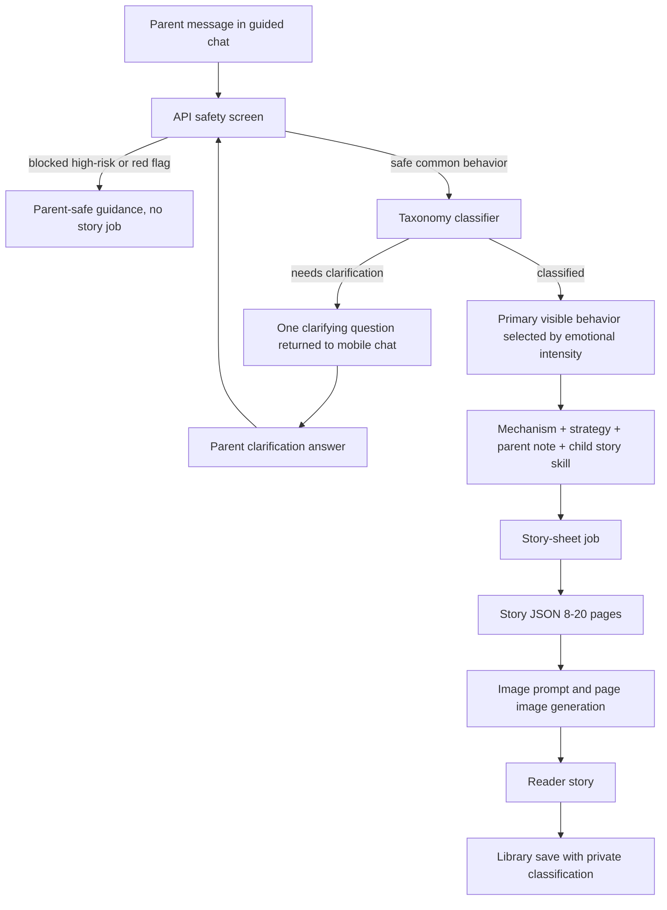

# feat: Add behavior taxonomy guided chat

## Summary

Build a behavior-classification layer that sits between the mobile story-creation chat and the existing story-sheet pipeline. The implementation should preserve the current generation flow while replacing string-split issue planning with curated taxonomy mapping, one-question clarification for vague prompts, mechanism-aware story focus, short parent notes, private classification persistence, and flexible 8-20 page story output.

---

## Problem Frame

Kahani currently accepts a single behavior prompt, performs safety/consent checks, starts one story-sheet job, generates story JSON, generates a storyboard sheet, slices images, opens the reader, and saves to Library. The current issue planner only splits obvious text fragments, so it cannot distinguish scene, visible behavior, underlying mechanism, strategy, parent guidance, or target outcome.

The plan must add that behavior intelligence without breaking the existing story creation handoff into story text, images, reader rendering, and Library persistence.

---

## Requirements

- R1. Story creation uses a hybrid guided chat, while clear prompts can still proceed without mandatory clarification.
- R2. Prompts are classified into scene/context, visible behavior, underlying mechanism, strategy, child story skill, parent guidance, and target outcome.
- R3. Vague or low-confidence prompts trigger one clarifying question, then map to the closest safe known category or decline if still outside scope.
- R4. Multi-issue prompts auto-pick the most emotionally intense visible behavior, while secondary issues stay out of the story.
- R5. Mechanism-aware stories address the visible behavior through the likely underlying strategy.
- R6. Strategies use mainstream child-development consensus and stay non-clinical.
- R7. Generated output includes one short parent note and remains story-first, not a coaching dashboard.
- R8. High-risk safety prompts and medical/developmental red flags are blocked or redirected before normal behavior mapping.
- R9. Classification may be saved privately with the generated story, but Library v1 does not show behavior labels.
- R10. The classification output must hand off into the existing story-sheet pipeline: story prompt, story JSON, image sheet prompt, image generation, slicing, reader, and Library save.
- R11. Story length must be flexible from 8 to 20 pages; no implementation path should assume exactly 12 story pages.

**Origin actors:** A1 parent account holder, A2 child listener, A3 Kahani behavior classifier, A4 Kahani story generator, A5 Kahani operator/editor

**Origin flows:** F1 clear behavior prompt, F2 vague or low-confidence prompt, F3 multiple mechanisms in one prompt, F4 safety or developmental red flag

**Origin acceptance examples:** AE1 bedtime separation anxiety, AE2 bedtime transition resistance, AE3 vague bedtime prompt, AE4 multi-issue bedtime prompt, AE5 parent note and story strategy alignment, AE6 progress not permanent correction, AE7 safety/red-flag refusal, AE8 private classification persistence

---

## Scope Boundaries

- No full therapy, diagnosis, clinical treatment positioning, or named clinical-framework claims.
- No full parenting plan dashboard in v1.
- No visible behavior labels in Library v1.
- No blended story that tries to correct several mechanisms at once.
- No unlimited LLM-invented taxonomy categories as source-of-truth.
- No promise that the child will be permanently corrected after reading.
- No generation for high-risk safety or medical/developmental red-flag prompts.
- No requirement to expose full classification details to parents.
- No photo-flow implementation in this plan; the separate local-photo requirements and plan own that work.

### Deferred to Follow-Up Work

- Longitudinal behavior tracking and measurable progress loops: defer until the core classification and story-generation path is trustworthy.
- Multiple-story behavior sequences for secondary issues: defer until v1 proves one focused story per request.
- Library labels, filters, and category browsing: defer until classification quality and saved-story volume justify parent-facing taxonomy UI.
- Durable DB-backed taxonomy persistence and analytics: defer to production-hardening work unless this implementation lands after that foundation exists.

---

## Context & Research

### Relevant Code and Patterns

- `artifacts/mobile/app/(tabs)/index.tsx` owns the current create-story screen, mutation call, job polling, generated story creation, reader navigation, issue notice, and consent prompt.
- `artifacts/mobile/context/StoryContext.tsx` owns local character/story persistence in AsyncStorage and is the place where private classification metadata can be attached to saved stories for v1.
- `lib/api-spec/openapi.yaml`, `lib/api-client-react/src/generated/*`, and `lib/api-zod/src/generated/*` define the generated API contract consumed by mobile and API server.
- `artifacts/api-server/src/routes/stories.ts` runs request parsing, auth, guardrails, consent, config checks, and starts story jobs.
- `artifacts/api-server/src/services/safety/inputGuardrails.ts` blocks prompt injection and high-risk safety before generation; red-flag behavior should extend this boundary before taxonomy mapping.
- `artifacts/api-server/src/services/story-sheet/planner.ts` is the existing story issue planner and should evolve from string splitting into taxonomy-based classification.
- `artifacts/api-server/src/services/story-sheet/jobs.ts` persists job metadata and currently stores `plannedIssues`, `activeIssue`, and `issueNotice`.
- `artifacts/api-server/src/services/story-sheet/generator.ts` builds the story prompt, sheet prompt, story JSON, image assets, and currently normalizes to a maximum of 12 pages.
- `scripts/data/story-json-master-prompt.txt` already says 12 pages is a maximum, but also says 6-12 pages; this needs to become 8-20 consistently.
- `scripts/data/sheet-master-prompt.txt`, `artifacts/api-server/src/services/story-sheet/mapper.ts`, and the slicer currently reflect a 4x4 sheet with 12 story panels after cover/open/end/blank panels.
- `docs/story-generation-spec.md` remains the story-quality foundation and says one issue per generated story.

### Institutional Learnings

- No `docs/solutions/` institutional learning files are present in this checkout.
- Existing production-readiness docs require prompt-injection and serious safety blocking before any provider work.
- Existing photo privacy work requires provider payloads to receive descriptors and redacted prompts, not family photos.

### External References

- CDC "Essentials for Parenting Toddlers and Preschoolers" emphasizes predictable structure, routines, and clear rules as mainstream parent guidance.
- AAP toddler parenting guidance supports routines and predictable expectations as a way to reduce tantrum likelihood.
- AAP guidance on big emotions supports choices, positive reinforcement, calming routines, and caregiver co-regulation.
- ZERO TO THREE guidance on reaction to change supports familiar objects, parent participation, and transition support for children who struggle with change.

---

## Key Technical Decisions

- Curated taxonomy plus classifier: encode scenes, visible behaviors, mechanisms, strategies, parent notes, story skills, target outcomes, red-flag markers, and intensity ranking in a reviewed artifact, then map free text into it. This satisfies the "no unlimited LLM categories" boundary while preserving natural parent input.
- Safety before taxonomy: prompt injection, high-risk safety, and developmental/medical red flags must run before normal behavior classification starts, so serious prompts cannot be softened into story requests.
- Classification as generation input: the selected classification becomes the source for the story prompt and parent note, not a side artifact. Existing story generation should receive a focused behavior package rather than raw parent wording alone.
- One clarification maximum: the API and mobile chat should support exactly one clarifying turn for v1; after that, the system maps or declines.
- Flexible pages through pipeline: story JSON should allow 8-20 pages, but the image pipeline needs an explicit strategy because the current 4x4 contact sheet only gives 12 story panels.
- Preserve current one-book flow: this plan changes what informs the story and how the parent enters it, but keeps the current job polling, reader open, and Library save model.

---

## Open Questions

### Resolved During Planning

- Taxonomy artifact location and shape: plan as a repo-owned reviewed data artifact consumed by backend classification tests, with generated/shared types only if implementation proves they are needed.
- Confidence threshold behavior: plan for a deterministic "needs clarification" result from classifier tests rather than choosing a magic numeric threshold in the requirements.
- Guardrail integration: run existing guardrails and new red-flag checks before taxonomy mapping.
- Private classification storage: attach normalized classification metadata to jobs and saved stories, but omit raw prompt text when normalized fields are sufficient.
- Flexible page count: update all story-generation contracts to 8-20 pages, and adjust image generation/slicing so generated page images are not limited by the old 12-panel layout.

### Deferred to Implementation

- Exact classifier scoring method: implementation may start deterministic with curated keywords/patterns and add LLM-assisted mapping only behind a bounded schema if needed.
- Exact page-image strategy: implementation should choose the simplest reliable way to support up to 20 story pages after inspecting provider behavior, but it must not leave a 12-page cap in place.
- Exact chat component decomposition: implementation should follow local mobile component patterns and keep the UI dense and app-like rather than marketing-style.

---

## High-Level Technical Design

> *This illustrates the intended approach and is directional guidance for review, not implementation specification. The implementing agent should treat it as context, not code to reproduce.*



The important integration point is `H -> I`: the existing story-sheet job should receive a normalized behavior package. The raw parent prompt can be retained only where necessary for generation quality or debugging-safe artifacts, not as the primary source of truth.

---

## Implementation Units

### U1. Add Curated Behavior Taxonomy

**Goal:** Create the reviewed taxonomy source that maps parent-facing scenes and visible behaviors to mechanisms, strategies, child story skills, parent guidance, target outcomes, intensity ranking, and red-flag boundaries.

**Requirements:** R2, R4, R5, R6, R8, R10; origin F1, F3, F4; origin AE1, AE2, AE5, AE7

**Dependencies:** None

**Files:**
- Create: `artifacts/api-server/src/services/story-sheet/behaviorTaxonomy.ts`
- Create: `artifacts/api-server/src/services/story-sheet/behaviorTaxonomy.test.ts`
- Modify: `artifacts/api-server/src/services/story-sheet/types.ts`
- Optional reference data if preferred during implementation: `scripts/data/behavior-taxonomy.json`

**Approach:**
- Define a v1 taxonomy with stable category IDs covering the scenes and mechanisms named in the origin requirements: bedtime, meals, screens, bath, school dropoff, public places, car seat, sharing, sibling play, cleanup, hygiene, and transitions.
- Each taxonomy entry should include parent-facing category text, scene/context, surface behavior aliases, mechanism, mainstream strategy, child story skill, short parent guidance, target outcome, intensity hints, and red-flag exclusions.
- Start with enough entries to cover acceptance examples and the current `scripts/data/behavior-prompts.json` prompts; do not attempt an exhaustive clinical taxonomy.
- Keep taxonomy language non-clinical and practical: routine, transition bridge, limited choices, co-regulation, connection before separation, repair, practice waiting, and gradual exposure.

**Execution note:** Implement taxonomy behavior test-first so the initial data shape is locked by examples before routing code depends on it.

**Patterns to follow:**
- Current seed behavior prompts in `scripts/data/behavior-prompts.json`.
- Existing story planner tests in `artifacts/api-server/src/services/story-sheet/planner.test.ts`.

**Test scenarios:**
- Happy path: "won't sleep alone" maps to a bedtime scene with separation anxiety mechanism and connection/separation strategy.
- Happy path: "won't stop playing to get ready for bed" maps to bedtime scene with transition resistance and a transition ritual strategy.
- Happy path: "won't share blocks with friends" maps to sharing/play scene with turn-taking or frustration-tolerance strategy.
- Edge case: a taxonomy entry with missing parent guidance, child story skill, or target outcome fails validation.
- Edge case: aliases cannot map one phrase to two primary category IDs unless explicitly marked ambiguous.
- Error path: red-flag-only entries are not treated as normal story categories.

**Verification:**
- Taxonomy tests prove the minimum v1 category set is complete enough for documented acceptance examples and current prompt seed coverage.

---

### U2. Replace String-Split Planner with Classification Results

**Goal:** Replace the current `planStoryIssues` string-splitting behavior with taxonomy-backed classification that can return classified, needs-clarification, or blocked/red-flag outcomes.

**Requirements:** R2, R3, R4, R5, R8, R10; origin F1, F2, F3, F4; origin AE1, AE2, AE3, AE4, AE7

**Dependencies:** U1

**Files:**
- Modify: `artifacts/api-server/src/services/story-sheet/planner.ts`
- Modify: `artifacts/api-server/src/services/story-sheet/planner.test.ts`
- Modify: `artifacts/api-server/src/services/story-sheet/types.ts`
- Test: `artifacts/api-server/src/services/story-sheet/planner.test.ts`

**Approach:**
- Introduce a planning/classification result that distinguishes:
  - safe classified prompt with selected primary behavior package
  - needs one clarification question
  - out-of-scope/red-flag prompt that should not generate a behavior story
- Preserve the current ability to detect multiple issues, but rank primary selection by emotional intensity of visible behavior, not by text order.
- For v1, deterministic pattern and alias matching is acceptable if it is bounded by the curated taxonomy. If LLM-assisted mapping is added, it must output only known category IDs and a bounded confidence/clarification state.
- Carry secondary detected categories as metadata only; do not include them in story-generation focus.

**Technical design:** *(directional guidance, not implementation specification)*

```text
classification result:
  classified:
    primary: behavior package
    secondary: behavior packages[]
    parentNote: short note
    storyFocusLabel: parent-facing focus
  needsClarification:
    question: single parent-facing question
    choices: optional bounded choices
  blocked:
    reasonCategory: high-risk | developmental-red-flag | out-of-scope
    message: parent-safe guidance
```

**Patterns to follow:**
- Existing planner exports in `artifacts/api-server/src/services/story-sheet/planner.ts`.
- Guardrail result unions in `artifacts/api-server/src/services/safety/inputGuardrails.ts`.

**Test scenarios:**
- Covers AE1. Happy path: "my child won't sleep alone" classifies as bedtime + separation anxiety.
- Covers AE2. Happy path: "my child won't stop playing to get ready for bed" classifies as bedtime + transition resistance.
- Covers AE3. Edge case: "bedtime is awful" returns one clarifying question and does not start a story package.
- Covers AE4. Integration: "won't change clothes, asks me to stay, and screams when bedtime starts" detects several issues but selects the screaming/meltdown visible behavior as primary.
- Happy path: visible intense behavior uses likely mechanism strategy rather than a generic "stop screaming" strategy.
- Error path: prompt with self-harm or serious medical/developmental concern returns blocked/referral classification and no story package.
- Edge case: prompt with unknown but non-risky language asks clarification once, then maps or declines on second pass.

**Verification:**
- Planner tests demonstrate scene/mechanism classification, one-question clarification, emotional-intensity ranking, and blocked red-flag behavior without provider calls.

---

### U3. Extend Safety Screening for Developmental and Medical Red Flags

**Goal:** Ensure high-risk safety and developmental/medical red flags are handled before behavior taxonomy mapping and before any generation job starts.

**Requirements:** R3, R8; origin F4; origin AE7

**Dependencies:** U1, U2

**Files:**
- Modify: `artifacts/api-server/src/services/safety/inputGuardrails.ts`
- Modify: `artifacts/api-server/src/services/safety/inputGuardrails.test.ts`
- Modify: `artifacts/api-server/src/routes/stories.guardrails.test.ts`
- Modify: `artifacts/api-server/src/routes/books.guardrails.test.ts`

**Approach:**
- Keep existing prompt-injection and high-risk safety behavior intact.
- Add a distinct red-flag path for developmental/medical concerns that should not become behavior-correction stories, such as loss of speech, serious eating/weight loss, severe repeated violence, or harm to animals.
- Use parent-safe referral language for red flags and preserve urgent guidance for high-risk safety.
- Ensure route-level tests prove blocked prompts never reach story job start.

**Patterns to follow:**
- Existing `InputGuardrailResult` union and route guardrail tests.
- Existing staging guardrail fixtures from recent production-readiness work.

**Test scenarios:**
- Covers AE7. Error path: self-harm prompt returns blocked high-risk guidance before classification/generation.
- Covers AE7. Error path: "not speaking at age 4" returns developmental referral guidance rather than a behavior story.
- Covers AE7. Error path: "won't eat and is losing weight" returns medical referral guidance rather than a behavior story.
- Regression: prompt injection still returns the existing prompt-injection category.
- Integration: route tests prove `startStorySheetJob` is not invoked for high-risk or red-flag prompts.

**Verification:**
- Safety tests distinguish urgent/high-risk prompts from developmental/medical referral prompts while preserving existing prompt-injection behavior.

---

### U4. Update API Contract for Classification and Clarification

**Goal:** Add API fields that let mobile send guided chat context, receive clarification/focus/parent-note responses, and fetch private classification metadata with generated stories where needed.

**Requirements:** R1, R2, R3, R7, R9, R10; origin F1, F2, F3; origin AE3, AE5, AE8

**Dependencies:** U2, U3

**Files:**
- Modify: `lib/api-spec/openapi.yaml`
- Regenerate/modify generated outputs: `lib/api-client-react/src/generated/api.ts`
- Regenerate/modify generated outputs: `lib/api-client-react/src/generated/api.schemas.ts`
- Regenerate/modify generated outputs: `lib/api-zod/src/generated/api.ts`
- Modify: `artifacts/api-server/src/routes/stories.ts`
- Modify: `artifacts/api-server/src/routes/books.ts`
- Test: `artifacts/api-server/src/routes/generationConsent.test.ts`
- Test: `artifacts/api-server/src/routes/stories.guardrails.test.ts`

**Approach:**
- Extend generation request shape to include optional chat clarification context, without making the current simple prompt request invalid.
- Extend job accepted/status response to include parent-facing story focus, short parent note, selected classification summary, and clarification request when generation is not ready to start.
- Decide during implementation whether clarification is represented as a non-202 response or a 202-like planning response; the contract must be explicit and generated clients must reflect it.
- Ensure private classification metadata is returned only where needed for mobile save, and avoid raw prompt text if normalized fields are sufficient.
- Keep auth, consent, guardrail, and provider config checks in the existing route order, with safety before classification.

**Patterns to follow:**
- Existing OpenAPI-generated client/zod flow from `lib/api-spec/openapi.yaml`.
- Existing `StoryGenerationJob` and `StoryGenerationStatus` response shapes.

**Test scenarios:**
- Happy path: clear prompt returns accepted story job with story focus and parent note.
- Covers AE3. Edge case: vague prompt returns one clarification request and no provider job starts.
- Integration: parent clarification answer submitted after a vague prompt can start a classified story job.
- Covers AE8. Happy path: completed generated story can carry private normalized classification metadata for saving.
- Error path: red-flag prompt returns blocked/referral response and no classification metadata pretending it is a normal category.
- Regression: existing clear prompt clients still work if they do not provide chat context.

**Verification:**
- API schema, generated clients, generated zod schemas, and route behavior agree on clear, clarification, blocked, and completed-story shapes.

---

### U5. Thread Classification into Story Prompt, Job Metadata, and Parent Note

**Goal:** Make the selected behavior package the source of truth for story generation, parent note, job status, and saved story metadata.

**Requirements:** R2, R4, R5, R6, R7, R9, R10; origin F1, F3; origin AE4, AE5, AE6, AE8

**Dependencies:** U2, U4

**Files:**
- Modify: `artifacts/api-server/src/services/story-sheet/jobs.ts`
- Modify: `artifacts/api-server/src/services/story-sheet/generator.ts`
- Modify: `artifacts/api-server/src/services/story-sheet/types.ts`
- Modify: `scripts/data/story-json-master-prompt.txt`
- Test: `artifacts/api-server/src/services/story-sheet/generator.test.ts`
- Test: `artifacts/api-server/src/services/story-sheet/planner.test.ts`

**Approach:**
- Store selected classification on the job alongside active issue/focus so status and completed story can expose parent note and private metadata.
- Build story prompt behavior from selected visible behavior + mechanism + child story skill + target outcome, not raw parent text alone.
- Include parent guidance only as a parent-facing note or generation context; avoid turning page text into direct advice.
- Ensure secondary issues do not leak into the story prompt as subplots.
- Update prompt wording so the story shows practice/progress and does not claim permanent behavior correction.

**Patterns to follow:**
- Existing `buildBehaviorPrompt`, `buildStoryPrompt`, and `normalizeStoryJson` flow in `artifacts/api-server/src/services/story-sheet/generator.ts`.
- Existing `activeIssue` / `issueNotice` job metadata in `artifacts/api-server/src/services/story-sheet/jobs.ts`.

**Test scenarios:**
- Covers AE4. Integration: multi-issue bedtime prompt generates story context for the primary intense visible behavior only.
- Covers AE5. Happy path: parent note and story prompt use the same strategy, such as a predictable transition ritual.
- Covers AE6. Happy path: generated prompt instructions require practice/progress, not permanent correction.
- Edge case: secondary categories are persisted as metadata but not included in story prompt instructions as additional plot goals.
- Regression: random mode still produces a warm imaginative story and does not require behavior taxonomy classification unless product scope says otherwise.

**Verification:**
- Story generation artifacts show the selected classification drives behavior wording, parent note, and job metadata while preserving one focused story.

---

### U6. Support Flexible 8-20 Page Stories Through Story JSON and Image Pipeline

**Goal:** Remove the hard 12-page story limit and make story text, image generation, slicing, reader mapping, and Library save tolerate 8-20 story pages.

**Requirements:** R10, R11; carries the user's confirmed flexible page-count correction

**Dependencies:** U4, U5

**Files:**
- Modify: `lib/api-spec/openapi.yaml`
- Modify: `lib/api-client-react/src/generated/api.schemas.ts`
- Modify: `lib/api-zod/src/generated/api.ts`
- Modify: `scripts/data/story-json-master-prompt.txt`
- Modify: `scripts/data/sheet-master-prompt.txt`
- Modify: `scripts/src/slice-sheet.py` if still used by scripts
- Modify: `artifacts/api-server/src/services/story-sheet/generator.ts`
- Modify: `artifacts/api-server/src/services/story-sheet/mapper.ts`
- Modify: `artifacts/api-server/src/services/story-sheet/html.ts`
- Test: `artifacts/api-server/src/services/story-sheet/generator.test.ts`
- Test: `artifacts/api-server/src/services/story-sheet/mapper.test.ts`

**Approach:**
- Update story prompt and schema constraints to 8-20 story pages.
- Remove `slice(0, 12)` and any other implicit 12-page truncation.
- Replace or extend the 4x4 sheet assumption so stories above 12 pages can still receive images. The simplest acceptable implementation may generate multiple sheets or a larger/different contact sheet, but the output contract must map every story page to the correct image.
- Preserve support for shorter stories by leaving unused image slots blank or omitting them from mapping, depending on the chosen image strategy.
- Ensure reader and Library work even when some image generation fails safely or when story page count is at either bound.

**Technical design:** *(directional guidance, not implementation specification)*

```text
story pages: 8-20
image assets:
  cover image
  end image
  story page images[story.pages.length]
mapping invariant:
  generatedStory.pages.length === storyJson.pages.length
  every generatedStory page keeps stable text/pageNumber
  imageUrl is present for successfully generated/sliced page image
```

**Patterns to follow:**
- Existing mapper page-image lookup in `artifacts/api-server/src/services/story-sheet/mapper.ts`.
- Existing generated story min/max shape in `lib/api-spec/openapi.yaml`.

**Test scenarios:**
- Happy path: 8-page story normalizes, maps, renders reader cards, and has 8 generated story pages.
- Happy path: 20-page story normalizes, maps, renders reader cards, and has 20 generated story pages.
- Regression: 12-page story still works.
- Edge case: generated JSON with fewer than 8 story pages is rejected or repaired according to existing story JSON validation approach.
- Edge case: generated JSON with more than 20 story pages is capped or rejected without silently dropping page text.
- Integration: image asset mapping does not assign the wrong illustration to a page when more than 12 pages exist.
- Integration: reader and Library save preserve all story pages and metadata for 8, 12, and 20 page stories.

**Verification:**
- No 12-page hard cap remains in story prompt, normalization, schema, mapper, reader handoff, or tests; 8 and 20 page fixtures pass.

---

### U7. Build Mobile Guided Chat Story Creation

**Goal:** Replace the static prompt-box interaction with a compact guided chat that supports clear prompt fast-path, one clarification turn, focus note, parent note, generation progress, reader navigation, and errors.

**Requirements:** R1, R3, R7, R9, R10; origin F1, F2, F3, F4; origin AE3, AE5, AE7, AE8

**Dependencies:** U4, U5, U6

**Files:**
- Modify: `artifacts/mobile/app/(tabs)/index.tsx`
- Modify: `artifacts/mobile/context/StoryContext.tsx`
- Create or modify: `artifacts/mobile/services/storyChat.ts`
- Test: add mobile service tests near `artifacts/mobile/services/` for chat state and saved classification behavior

**Approach:**
- Replace the single prompt area with a scrollable chat region and bottom composer, matching the app's quiet storybook theme rather than a marketing hero.
- Clear prompt path: submit parent message, show Kahani focus/parent note, start generation.
- Vague prompt path: render one Kahani clarifying question, accept the parent's answer, then resubmit with clarification context.
- Multiple issue path: do not ask parent to choose; show the selected focus only.
- Safety/red-flag path: show blocked/referral language and do not start polling.
- Store private classification metadata on the saved story object, but do not display behavior labels in Library v1.
- Preserve existing consent prompt and job polling behavior.

**Patterns to follow:**
- Existing mobile generation flow in `artifacts/mobile/app/(tabs)/index.tsx`.
- Existing AsyncStorage persistence in `artifacts/mobile/context/StoryContext.tsx`.
- Existing Kahani design components in `artifacts/mobile/components/KahaniDesign.tsx`.

**Test scenarios:**
- Happy path: clear prompt shows focus/parent note, starts generation, opens reader when complete, and saves story with private classification metadata.
- Covers AE3. Edge case: vague prompt renders one clarification question before generation.
- Covers AE4. Happy path: multi-issue prompt displays selected focus and does not ask the parent to choose.
- Covers AE7. Error path: high-risk/red-flag response displays guidance and does not start polling.
- Covers AE8. Integration: Library shows saved story title/pages as before, without a behavior taxonomy label.
- Edge case: chat scroll handles parent message, Kahani clarification, parent answer, progress states, and error text without overlapping controls on phone-sized screens.
- Regression: external text AI consent still gates generation before provider-backed story work.

**Verification:**
- Mobile create-story flow works for clear, vague, multi-issue, and blocked prompts while preserving reader navigation and Library save behavior.

---

### U8. Update Story Reader and Library Persistence for Classification and Variable Length

**Goal:** Ensure saved stories, current stories, reader rendering, and Library behavior preserve variable page counts and private classification metadata without exposing labels.

**Requirements:** R9, R10, R11; origin AE8

**Dependencies:** U6, U7

**Files:**
- Modify: `artifacts/mobile/context/StoryContext.tsx`
- Modify: `artifacts/mobile/app/book-reader.tsx`
- Modify: `artifacts/mobile/app/(tabs)/library.tsx`
- Test: add or update mobile service/context tests if test harness supports the context layer

**Approach:**
- Extend the local `Story` type with optional private classification metadata needed for future continuity.
- Ensure story page arrays are not assumed to be 12 in reader, Library, or save paths.
- Keep Library UI unchanged for v1: title/cover/story access only, no behavior labels.
- Ensure old saved stories without classification metadata still load.

**Patterns to follow:**
- Existing story object shape in `artifacts/mobile/context/StoryContext.tsx`.
- Existing reader page rendering in `artifacts/mobile/app/book-reader.tsx`.

**Test scenarios:**
- Covers AE8. Happy path: a classified generated story saves metadata privately and Library does not display taxonomy labels.
- Happy path: 8-page and 20-page stories open in reader with all pages available.
- Regression: old saved stories without classification metadata still load and open.
- Edge case: story with missing image URL for one page still renders text and does not crash.

**Verification:**
- Reader and Library preserve variable page counts and private classification metadata while keeping v1 UI labels hidden.

---

### U9. Update Documentation, Fixtures, and End-to-End Verification

**Goal:** Document the taxonomy/chat generation contract and add synthetic fixtures that prove the full flow from chat classification to story/image/reader/Library is covered.

**Requirements:** R1-R11; origin F1-F4; origin AE1-AE8

**Dependencies:** U1-U8

**Files:**
- Modify: `docs/story-generation-spec.md`
- Create: `docs/staging/behavior-taxonomy-smoke-fixtures.md`
- Modify: `docs/staging/smoke-test-checklist.md`
- Test: route/service/mobile tests from prior units; no separate doc-only test required

**Approach:**
- Update story-generation docs so the canonical flow is chat -> classification -> selected behavior package -> story JSON -> image assets -> reader -> Library.
- Add synthetic fixtures for clear bedtime separation, bedtime transition resistance, vague bedtime, multi-issue bedtime, high-risk safety, developmental red flag, and 8/20 page story boundaries.
- Extend staging smoke checklist to include one non-spend classification-only/clarification test and one provider-backed allowed generation test after the feature is deployed.
- Keep documentation explicit that the product uses mainstream guidance and does not provide diagnosis or therapy.

**Patterns to follow:**
- Existing `docs/staging/smoke-test-checklist.md` structure.
- Existing `docs/story-generation-spec.md` story-quality requirements.

**Test scenarios:**
- Test expectation: none for docs-only changes, but docs must reference the feature tests and synthetic fixtures created by earlier units.

**Verification:**
- A new implementer can understand the full behavior-taxonomy chat flow and run the synthetic smoke path without reading the brainstorm doc first.

---

## System-Wide Impact

- **Interaction graph:** Mobile chat sends parent prompt/clarification to API; API runs auth, guardrails, consent, taxonomy classification, job start, job status, story fetch; backend story generation feeds image generation and slicing; mobile reader and Library consume the completed generated story.
- **Error propagation:** Safety and red-flag blocks return parent-safe guidance; vague prompts return one clarification; provider or story-job failures continue through existing failed generation states.
- **State lifecycle risks:** Chat state, job state, saved story state, and private classification metadata must stay aligned. A generated story should not be saved without the classification metadata when available.
- **API surface parity:** `/stories/generate` and legacy `/books` routes should remain behaviorally consistent for guardrails and generation, or `/books` should be explicitly documented as compatibility-only if not updated.
- **Integration coverage:** Unit tests alone will not prove the handoff from classification to story prompt to image mapping; integration fixtures need clear, vague, multi-issue, blocked, 8-page, and 20-page cases.
- **Unchanged invariants:** Provider payloads still must not receive raw photos; external text AI consent remains required; generated stories still open in reader and save to active profile Library.

---

## Risks & Dependencies

| Risk | Mitigation |
|------|------------|
| Classifier chooses a plausible but wrong mechanism | Use curated taxonomy, deterministic acceptance fixtures, one clarification for vague prompts, and keep parent-facing focus text visible before generation. |
| Behavior stories start sounding like therapy or advice | Keep parent note short, encode story-first prompt constraints, and test that story prompt uses child story skill rather than parent-plan language. |
| Multi-issue prompts produce muddy stories | Persist secondary issues only as metadata and test that story prompt uses only the primary visible behavior and likely mechanism strategy. |
| Flexible 8-20 pages breaks image generation | Treat page count as a cross-pipeline requirement and test mapper/slicer/reader behavior at 8, 12, and 20 pages. |
| Mobile chat becomes open-ended parenting chatbot | Scope chat state to story creation, one clarification, generation progress, and blocked guidance only. |
| Red flags are accidentally normalized into common behavior categories | Run guardrails/red-flag checks before taxonomy mapping and test no story job starts for red-flag prompts. |
| Saved classification leaks sensitive raw parent language | Save normalized category/scene/strategy metadata, not raw prompt text, unless a later production persistence design explicitly protects it. |

---

## Documentation / Operational Notes

- Update staging smoke docs before asking non-engineers to evaluate the feature so they understand why some prompts clarify, some generate, and some block.
- Staging provider-backed smoke should use synthetic prompts only and should include one 8-page and one 20-page boundary fixture if provider cost allows.
- Product copy should avoid "diagnose," "treat," "expert diagnosis," "correct permanently," or similar clinical/permanent-change language.

---

## Sources & References

- **Origin document:** `docs/brainstorms/2026-05-20-behavior-taxonomy-chat-requirements.md`
- Related requirements: `docs/story-generation-spec.md`
- Related API spec: `lib/api-spec/openapi.yaml`
- Related mobile flow: `artifacts/mobile/app/(tabs)/index.tsx`
- Related persistence: `artifacts/mobile/context/StoryContext.tsx`
- Related backend route: `artifacts/api-server/src/routes/stories.ts`
- Related planner: `artifacts/api-server/src/services/story-sheet/planner.ts`
- Related generator: `artifacts/api-server/src/services/story-sheet/generator.ts`
- CDC structure and rules guidance: https://www.cdc.gov/parenting-toddlers/structure-rules/
- AAP toddler routines guidance: https://www.aap.org/en/patient-care/healthy-active-living-for-families/toddler-parenting/
- AAP handling big emotions guidance: https://www.aap.org/en/patient-care/media-and-children/center-of-excellence-on-social-media-and-youth-mental-health/qa-portal/qa-portal-library/qa-portal-library-questions/handling-big-emotions/
- ZERO TO THREE transition guidance: https://www.zerotothree.org/resource/temperament-reaction-to-change/
