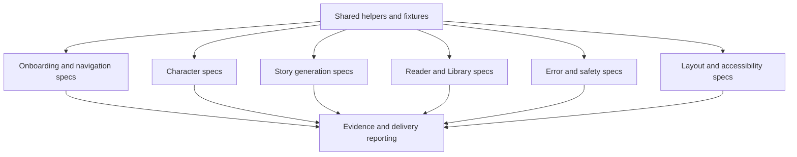

# feat: User-facing delivery e2e coverage

## Summary

Build the user-facing delivery checklist into executable Playwright coverage in a sequence that starts with shared test infrastructure, then splits into parallel spec batches by product area. The goal is not to automate every checklist row immediately; it is to create a reliable release guard for the P0 flow first, then expand P1/P2 coverage with evidence output and clear native/manual boundaries.

---

## Problem Frame

The new delivery QA documents define what must be proven before Kahani is considered parent-facing, but most of the matrix is still manual or scaffold-only. The repo currently has one broad e2e journey in `tests/e2e/character-story-library.spec.ts`, which proves the happy path but does not cover first-run states, blocked/safety responses, retry/error recovery, reader/library edge cases, or layout/accessibility smoke.

The work needs a plan that supports sequential build-up and parallel implementation: land common helpers and mock fixtures first, then let independent workers add focused spec files without stepping on each other.

---

## Requirements

- R1. Convert the delivery checklist into executable Playwright tests where web automation can prove the user-facing behavior.
- R2. Preserve the checklist as the source of truth by linking tests to UF IDs in titles, metadata, or evidence filenames.
- R3. Keep the existing full child + mom + dad -> generate -> reader -> Library journey as the core release guard.
- R4. Add shared helper and fixture infrastructure before parallel spec implementation starts.
- R5. Split specs by user-facing area so independent workers can implement test batches in parallel.
- R6. Record evidence for implemented UF items through Playwright screenshots, videos, traces, or report entries.
- R7. Mark native-only or provider-auth-only items as manual evidence requirements rather than pretending web tests prove them.
- R8. Ensure tests use synthetic data only and never real family names, photos, behavior notes, or production user data.
- R9. Keep local dev/test execution compatible with the existing Expo web Playwright setup.
- R10. Avoid adding brittle assertions that depend on provider-generated story content when route mocks can prove the same UI contract.

---

## Scope Boundaries

- This plan covers Playwright/web delivery automation plus documentation for manual/native-only boundaries.
- This plan does not automate real Clerk/social sign-in, Expo Go, native haptics, physical keyboard behavior, or real-device tap comfort.
- This plan does not run provider-backed story/image generation in CI; use mocked API responses for deterministic user-facing e2e tests.
- This plan does not replace the human delivery pass in `docs/staging/user-facing-delivery-tests.md`.
- This plan does not redesign UI. If a test exposes a UI bug, fix only the behavior or test hook needed for the checklist item unless the bug blocks delivery.

### Deferred to Follow-Up Work

- Native-device delivery evidence: capture real iPhone/Android notes or recordings for keyboard, haptics, tap comfort, and Expo Go behavior.
- Authenticated staging-provider smoke: run separately with a synthetic staging parent account once staging credentials and session handling are stable.
- CI policy: after local reliability is proven, decide which subset runs on every PR versus release candidate only.

---

## Context & Research

### Relevant Code and Patterns

- `docs/staging/user-facing-delivery-tests.md` defines the UF matrix, priorities, minimum delivery run, automation suggestions, manual QA script, and evidence standard.
- `tests/e2e/user-facing-delivery.scaffold.md` proposes the future delivery spec split, helper names, fixture names, coverage map, evidence convention, and native-only boundaries.
- `tests/e2e/character-story-library.spec.ts` is the existing executable happy-path journey and should be refactored into the new delivery helper structure rather than discarded.
- `playwright.config.ts` already runs Expo web with `EXPO_PUBLIC_API_BASE_URL=http://localhost:8080`, reuses an existing server, and writes to `output/playwright`.
- `artifacts/mobile/app/(tabs)/index.tsx`, `characters.tsx`, `library.tsx`, and `book-reader.tsx` expose many of the necessary `testID` hooks for character creation, generation, reader navigation, save, and library assertions.
- `artifacts/mobile/app/_layout.tsx` owns onboarding consent gating and may need stable test hooks for first-launch consent assertions.
- `artifacts/api-server/src/routes/stories.guardrails.test.ts` and `generationConsent.test.ts` already define API-level consent/guardrail behavior that e2e tests should surface in the UI.

### Institutional Learnings

- The delivery checklist explicitly requires synthetic data only.
- Prior story-generation work treats selected child identity as locked; tests should preserve that guard, especially multiple children and parent-only flows.
- Prompt-injection guardrails are the first production-readiness gate; e2e coverage should assert the parent-visible blocked state, not just API status.

### External References

- No external research needed. The repo already uses Playwright and has direct local patterns for route mocking, Expo web startup, and visible UI assertions.

---

## Key Technical Decisions

- Shared helpers first: parallel work should not begin until navigation, profile isolation, API route mocks, character helpers, and evidence helpers are stable.
- Mock API responses for release-guard e2e: this makes user-facing states deterministic and avoids provider spend, rate limits, and story-content randomness.
- Keep UF IDs visible in tests and evidence: this lets delivery managers trace automated evidence back to the checklist without reading code.
- Split by user-facing area, not by priority alone: priority decides release gating, but area-based files minimize fixture duplication and worker conflicts.
- Treat native-only rows as manual evidence: web Playwright can add closest-visible smoke coverage, but the plan must not mark native-only items as fully automated.

---

## Open Questions

### Resolved During Planning

- Source documents: use `docs/staging/user-facing-delivery-tests.md` and `tests/e2e/user-facing-delivery.scaffold.md` as the planning source.
- Execution order: build helper/fixture infrastructure first, then parallelize spec batches, then add final evidence/reporting and delivery documentation.
- First implementation target: prioritize P0 rows and the minimum delivery run before broad P1/P2 expansion.

### Deferred to Implementation

- Exact screenshot/video attachment format: align with Playwright `testInfo` APIs when implementing `saveEvidence`.
- Exact consent test hook names: add the smallest stable hooks needed when implementation reaches onboarding/consent tests.
- Whether to keep the original broad e2e file as a smoke wrapper or fully replace it with delivery specs: decide after the refactor proves equivalent coverage.

---

## High-Level Technical Design

> _This illustrates the intended approach and is directional guidance for review, not implementation specification. The implementing agent should treat it as context, not code to reproduce._

### Sequential and Parallel Build Shape

| Phase | Mode              | Units                  | Why                                                                                                   |
| ----- | ----------------- | ---------------------- | ----------------------------------------------------------------------------------------------------- |
| 1     | Sequential        | U1                     | Shared helpers, fixtures, route mocks, and evidence conventions must exist before spec workers split. |
| 2     | Parallel          | U2, U3, U4, U5, U6, U7 | Each spec file owns a separate user-facing area and mostly disjoint assertions.                       |
| 3     | Sequential fan-in | U8                     | Final report mapping, checklist status, and release guard wiring depend on all implemented specs.     |

---

## Implementation Units

### U1. Shared Delivery Test Foundation

**Goal:** Create the common helpers, synthetic fixtures, route mocks, and evidence utilities that all delivery specs use.

**Requirements:** R2, R4, R6, R8, R9, R10

**Dependencies:** None

**Files:**

- Create: `tests/e2e/delivery/helpers.ts`
- Create: `tests/e2e/delivery/fixtures.ts`
- Create: `tests/e2e/delivery/apiMocks.ts`
- Create: `tests/e2e/delivery/evidence.ts`
- Modify: `tests/e2e/character-story-library.spec.ts`
- Test: `tests/e2e/character-story-library.spec.ts`

**Approach:**

- Move reusable logic from the existing character/story/library test into shared helpers.
- Add synthetic family and behavior prompt fixtures from the delivery scaffold.
- Add deterministic API mocks for successful generation, clarification-needed response, blocked guardrail response, consent-required response, failed generation, and slow/polling generation.
- Add profile isolation helper using unique `profile` query params so tests do not share AsyncStorage state.
- Add evidence helper that attaches screenshot or test metadata using the UF ID.
- Keep the existing full journey passing after helper extraction before parallel work starts.

**Execution note:** Refactor test-first by keeping the existing e2e journey green after every helper extraction.

**Patterns to follow:**

- `tests/e2e/character-story-library.spec.ts` route mocking and visible assertions.
- `playwright.config.ts` baseURL and output directory configuration.

**Test scenarios:**

- Happy path: helper-based full journey still adds child, mom, dad, generates, opens reader, saves, and verifies Library.
- Edge case: `gotoFreshProfile` creates isolated storage for two different profiles in one test run.
- Error path: mock helpers can return consent-required, guardrail-blocked, failed, and long-running generation states without hitting a real provider.
- Integration: evidence helper attaches at least one screenshot/report artifact associated with a UF ID.

**Verification:**

- Existing full journey passes after being moved onto shared helpers.
- No helper uses real family data or provider-backed generation.

### U2. Onboarding, Consent, Navigation, and Empty-State Specs

**Goal:** Automate first-launch, app entry, navigation, and no-child generation blocking behaviors.

**Requirements:** R1, R2, R5, R6, R8, R9

**Dependencies:** U1

**Files:**

- Create: `tests/e2e/delivery/01-onboarding-navigation.spec.ts`
- Modify if needed: `artifacts/mobile/app/_layout.tsx`
- Modify if needed: `artifacts/mobile/app/(tabs)/index.tsx`

**Approach:**

- Cover first launch and required app consent with synthetic local profile state.
- Assert the parent can reach Create Story, Characters, and Library after accepting app consent or using the accepted-consent fixture.
- Cover no-child generation block before character creation.
- Add only stable test hooks needed to identify consent and navigation states.

**Patterns to follow:**

- Existing tab navigation assertions in `tests/e2e/character-story-library.spec.ts`.
- Onboarding consent service tests under `artifacts/mobile/services/onboardingConsent.test.ts`.

**Test scenarios:**

- Covers UF-001. Happy path: signed-out/local first launch shows a clear entry or consent screen, not a blank screen.
- Covers UF-003. Happy path: moving between Create Story, Characters, Library, and back navigation preserves visible app state.
- Covers UF-004. Error path: generating with no child character sends the parent to add a character or shows the add-character prompt without calling the API.
- Edge case: declined app consent does not show the normal app tabs.

**Verification:**

- First-run and no-child states are deterministic and do not depend on real auth.

### U3. Character Creation and Identity Specs

**Goal:** Automate child/parent character creation, main-child selection, photo privacy copy, manual fallback, and identity-risk cases.

**Requirements:** R1, R2, R5, R6, R8, R9

**Dependencies:** U1

**Files:**

- Create: `tests/e2e/delivery/02-characters.spec.ts`
- Modify if needed: `artifacts/mobile/app/(tabs)/characters.tsx`
- Modify if needed: `artifacts/mobile/app/(tabs)/index.tsx`

**Approach:**

- Reuse `addCharacter` helper for Riley, Maya, Noah, Casey, long synthetic names, and multiple children.
- Assert parent characters do not become the main story child.
- Add synthetic photo-path coverage using a fake image only when the local web picker path is testable; otherwise assert visible privacy/fallback UI and leave native picker proof as manual.
- Keep generated cartoon/raw-photo assertions scoped to UI-visible behavior and storage-safe fields where web can inspect state.

**Patterns to follow:**

- Character relationship segmented control test IDs from `CharacterAvatar` and `SegmentedControl`.
- `artifacts/mobile/services/characterPrivacy.test.ts` for storage privacy expectations.

**Test scenarios:**

- Covers UF-005. Happy path: add Riley without a real photo; Riley appears in Characters and Create Story.
- Covers UF-006 and UF-007. Happy path: add Maya and Noah; Riley remains the selected story subject.
- Covers UF-031. Edge case: add two child characters and select the second; generation uses the selected child.
- Covers UF-032. Error path: parent-only characters cannot generate as the child.
- Covers UF-033. Edge case: long synthetic child name does not break visible character cards or story subject selection.
- Covers UF-008 and UF-009 where web-capable. Privacy path: fake photo or fallback flow never leaves the original photo as the saved final character asset.

**Verification:**

- Character identity assertions prevent the selected-child mismatch class.
- Photo tests use only synthetic images and do not require real media.

### U4. Story Generation, Clarification, Consent, and Progress Specs

**Goal:** Automate parent-visible story generation states before reader handoff.

**Requirements:** R1, R2, R3, R5, R6, R8, R9, R10

**Dependencies:** U1, U3

**Files:**

- Create: `tests/e2e/delivery/03-story-generation.spec.ts`
- Modify if needed: `artifacts/mobile/app/(tabs)/index.tsx`

**Approach:**

- Mock normal generation, consent-required response, clarification-needed response, long-running status, and long prompt handling.
- Assert behavior-only mode, selected child name, supporting characters, and progress UI.
- Keep generated story content deterministic through route mocks.

**Patterns to follow:**

- `tests/e2e/character-story-library.spec.ts` request-body capture and route fulfillment.
- `artifacts/api-server/src/routes/generationConsent.test.ts` and `stories.guardrails.test.ts` response contracts.
- `artifacts/mobile/services/storyChat.test.ts` clarification message behavior.

**Test scenarios:**

- Covers UF-010. Error path: missing external text AI consent shows parent-visible consent flow and no silent story start.
- Covers UF-011. Happy path: story generation starts and progress is visible.
- Covers UF-012 and UF-013. Integration: request body uses selected child and supporting characters correctly.
- Covers UF-014. Happy path: submitted request uses behavior mode for behavior prompts.
- Covers UF-015. Edge case: vague bedtime prompt shows one clarification and no story job starts before answer.
- Covers UF-026. Edge case: long-running generation keeps progress visible until completion or safe failure.
- Covers UF-034. Edge case: long behavior prompt remains usable and focuses the generated request on the main behavior.

**Verification:**

- Story-generation tests prove pre-reader user states without provider calls.

### U5. Reader and Library Specs

**Goal:** Automate reader paging, end page, save, persistence, reopen, delete, image fallback, and account/profile boundaries.

**Requirements:** R1, R2, R3, R5, R6, R8, R9, R10

**Dependencies:** U1, U4

**Files:**

- Create: `tests/e2e/delivery/04-reader-library.spec.ts`
- Modify if needed: `artifacts/mobile/app/book-reader.tsx`
- Modify if needed: `artifacts/mobile/app/(tabs)/library.tsx`
- Modify if needed: `artifacts/mobile/context/StoryContext.tsx`

**Approach:**

- Use mocked completed stories with varied page counts, missing images, present images, and stable IDs.
- Assert page navigation, readable text, reflection question, save state, Library rows, refresh/reopen persistence, and delete confirm/cancel behavior.
- Use separate synthetic profiles to prove account/profile boundary on web.

**Patterns to follow:**

- Reader test IDs in `book-reader.tsx`.
- Library test IDs in `library.tsx`.
- AsyncStorage profile isolation in `StoryContext.tsx`.

**Test scenarios:**

- Covers UF-018. Happy path: reader cover shows title, ownership, art/placeholder, and page count.
- Covers UF-019. Happy path: all pages render in order and navigation buttons work.
- Covers UF-020 and UF-021. Happy path: end page shows reflection question and save confirms saved state.
- Covers UF-022 and UF-023. Integration: refresh/reopen preserves characters and saved story for the same profile.
- Covers UF-024. Error path: delete cancel keeps story; delete confirm removes it.
- Covers UF-035. Edge case: near-maximum page count navigates without skipped pages.
- Covers UF-036 and UF-037. Edge case: missing images show polished placeholders; present images render where expected.
- Covers UF-038. Happy path: empty Library state is clear and not confused with saved stories.
- Covers UF-039. Integration: different synthetic profiles do not see each other's saved library state.

**Verification:**

- Reader/Library tests can run independently from story-generation tests using seeded or mocked story state.

### U6. Error, Safety, Offline, and Retry Specs

**Goal:** Automate parent-visible blocked, failed, offline, retry, and recovery states.

**Requirements:** R1, R2, R5, R6, R8, R9, R10

**Dependencies:** U1, U3

**Files:**

- Create: `tests/e2e/delivery/05-error-safety.spec.ts`
- Modify if needed: `artifacts/mobile/app/(tabs)/index.tsx`

**Approach:**

- Mock prompt-injection and high-risk safety responses from the API and assert safe parent-visible errors.
- Mock failed generation and retry success.
- Simulate network unavailable or failed status polling where Playwright can do so deterministically.
- Cover refresh/reopen during progress only if the current app has recoverable job state; otherwise document the gap as manual/follow-up.

**Patterns to follow:**

- API guardrail tests in `artifacts/api-server/src/routes/stories.guardrails.test.ts`.
- Generation error UI in `artifacts/mobile/app/(tabs)/index.tsx`.

**Test scenarios:**

- Covers UF-016. Error path: prompt injection produces safe blocked UI and no story reader.
- Covers UF-017. Error path: urgent medical/self-harm fixture produces safe guidance and no story reader.
- Covers UF-025. Error path: failed generation shows clear story-not-ready style error and preserves characters.
- Covers UF-042 where web-capable. Edge case: network unavailable after previous use does not crash the app.
- Covers UF-043. Happy path after failure: retry can start without restarting the app or re-adding the child.
- Covers UF-044 if supported. Edge case: refresh during progress results in recoverable UI or documented unsupported state.

**Verification:**

- Safety/error tests never send real risky content to a provider because all API responses are mocked.

### U7. Layout, Theme, Keyboard, Accessibility, and Polish Smoke Specs

**Goal:** Automate web-visible layout and accessibility smoke while explicitly preserving native-only manual evidence requirements.

**Requirements:** R1, R2, R5, R6, R7, R8, R9

**Dependencies:** U1

**Files:**

- Create: `tests/e2e/delivery/06-layout-accessibility.spec.ts`
- Modify if needed: `artifacts/mobile/components/KahaniDesign.tsx`
- Modify if needed: `artifacts/mobile/app/(tabs)/index.tsx`
- Modify if needed: `artifacts/mobile/app/book-reader.tsx`

**Approach:**

- Run the core flow at phone-sized and desktop-sized viewports.
- Assert no obvious text overlap or hidden primary actions using visible locators and screenshots.
- Toggle theme during Create Story and reader use.
- Add accessibility-label checks for main buttons, tabs, inputs, reader navigation, and delete controls where hooks are missing.
- Document UF rows that require physical-device evidence.

**Patterns to follow:**

- Existing `ThemeToggle` accessibility label.
- `CharacterAvatar`, `KahaniButton`, `ReaderNavButton`, and delete control patterns in `KahaniDesign.tsx`.

**Test scenarios:**

- Covers UF-027 and UF-028. Layout: core flows remain usable at phone and desktop browser sizes.
- Covers UF-029. Happy path: theme toggle changes UI without making primary text unreadable.
- Covers UF-030 partially. Web keyboard/input proxy: multi-line behavior prompt remains visible and generate action remains reachable; physical keyboard evidence remains manual.
- Covers UF-040. Accessibility: main buttons, tabs, text input, and reader navigation have understandable labels or roles.
- Covers UF-041 and UF-045 manually. Native tap comfort and haptics are not considered fully proven by web automation.
- Covers UF-046, UF-047, UF-048. Polish smoke: no developer placeholder text in core flow, sample content is clearly fake, and basic page transitions are responsive enough for smoke.

**Verification:**

- Layout/accessibility tests produce screenshots for each viewport class and clearly mark native-only rows as manual.

### U8. Delivery Evidence, Checklist Mapping, and Release Guard

**Goal:** Make the implemented suite useful to delivery managers by mapping results back to the UF checklist and preserving manual boundaries.

**Requirements:** R2, R3, R6, R7, R8, R9

**Dependencies:** U2, U3, U4, U5, U6, U7

**Files:**

- Modify: `docs/staging/user-facing-delivery-tests.md`
- Modify: `tests/e2e/user-facing-delivery.scaffold.md`
- Create if useful: `tests/e2e/delivery/README.md`
- Modify if needed: `package.json`
- Modify if needed: `playwright.config.ts`

**Approach:**

- Update the scaffold document from "not executable yet" to the actual implemented structure once specs land.
- Add a lightweight delivery README explaining how to run the full suite, the minimum P0 run, and where evidence lands.
- Keep the existing `npm run test:e2e` behavior intact; add a narrower delivery script only if it improves repeated use without breaking existing workflows.
- Update manual/native-only rows with explicit evidence expectations instead of marking them automated.

**Patterns to follow:**

- Evidence standard and Delivery Report Template in `docs/staging/user-facing-delivery-tests.md`.
- Existing root `test:e2e` script.

**Test scenarios:**

- Integration: full delivery suite can be run locally and produces Playwright output under `output/playwright`.
- Integration: minimum delivery run maps to all required P0 automated rows plus documented manual rows.
- Edge case: a failed UF row leaves enough report evidence to identify the checklist item and owner.

**Verification:**

- Delivery docs and scripts explain exactly what is automated, what remains manual, and how to collect evidence for a release candidate.

---

## System-Wide Impact

- **Interaction graph:** Playwright drives Expo web, mocks API routes, writes evidence, and asserts mobile UI states across Create Story, Characters, Reader, Library, and app consent.
- **Error propagation:** Mocked API error states must surface through the same UI paths parents see in real failures.
- **State lifecycle risks:** AsyncStorage profile isolation is load-bearing; tests must not share characters, stories, consent, or library data across profiles.
- **API surface parity:** E2e mocks should follow the same response contracts covered by API route tests so UI tests do not diverge from backend behavior.
- **Integration coverage:** Unit tests prove guardrail/consent logic; these e2e tests prove parent-visible handling of those states.
- **Unchanged invariants:** No real family data, no provider-backed generation, no production account data, and no false automation claims for native-only checks.

---

## Risks & Dependencies

| Risk                                                                 | Mitigation                                                                                                              |
| -------------------------------------------------------------------- | ----------------------------------------------------------------------------------------------------------------------- |
| Parallel workers collide in shared helper files                      | Land U1 first, then assign each parallel worker one spec file with helpers treated as stable unless a blocker is found. |
| Tests become brittle due to generated story content                  | Mock story responses and assert UI contracts, request shape, and visible state rather than provider prose.              |
| Checklist rows appear automated when they are only partially covered | Keep native/manual boundaries in docs and evidence naming; do not mark native-only rows as fully automated.             |
| Playwright web differs from Expo Go/native behavior                  | Use web automation as release guard for shared UI logic and require manual real-device evidence for native-only rows.   |
| Evidence output becomes hard to trace                                | Include UF IDs in test titles, evidence names, and report attachments.                                                  |

---

## Documentation / Operational Notes

- Commit `docs/staging/user-facing-delivery-tests.md` and `tests/e2e/user-facing-delivery.scaffold.md` with this plan or before implementation so the plan source is durable.
- Prefer one worker per spec file after U1 lands. If a worker discovers a missing helper, pause and update U1/shared helpers before continuing with the rest of the parallel batch.
- The first delivery gate should be P0-focused. P1/P2 tests can expand after the minimum delivery run is stable and not flaky.

---

## Sources & References

- **Source checklist:** [docs/staging/user-facing-delivery-tests.md](../staging/user-facing-delivery-tests.md)
- **Scaffold document:** [tests/e2e/user-facing-delivery.scaffold.md](../../tests/e2e/user-facing-delivery.scaffold.md)
- Existing e2e test: `tests/e2e/character-story-library.spec.ts`
- Playwright config: `playwright.config.ts`
- Mobile Create Story: `artifacts/mobile/app/(tabs)/index.tsx`
- Mobile Characters: `artifacts/mobile/app/(tabs)/characters.tsx`
- Mobile Reader: `artifacts/mobile/app/book-reader.tsx`
- Mobile Library: `artifacts/mobile/app/(tabs)/library.tsx`
