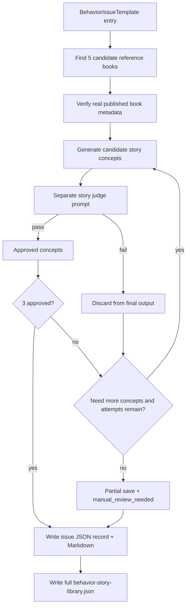

# feat: Generate behavior story concept library

## Summary

Add an offline batch workflow that turns the 100 behavior issue templates into a reusable story-concept library. The workflow should verify real published reference books, generate candidate story concepts, judge them with a separate QA prompt, and write both app-readable JSON and human-readable Markdown review files.

---

## Problem Frame

The current live story pipeline can still produce weak or generic stories even with stronger prompts and QA. The library generator creates a curated prewritten content base first, so story quality can be reviewed and improved before those concepts become parent-facing app content.

---

## Requirements

- R1. The first library version must cover the 100 behavior issues from the behavior source data.
- R2. Each behavior issue should target three approved story concepts.
- R3. If fewer than three concepts pass automatic QA after max attempts, save the approved partial set and mark the issue as needing manual review.
- R4. Each behavior issue must store five real published children's books in JSON as reference books.
- R5. The same reference book may be reused across multiple behavior issues when it is genuinely relevant.
- R6. Reference books must not appear in the Markdown review files for v1.
- R7. Each story concept must use the short narrative concept format: title, core theme, story summary, optional repeated tools or rituals, ending message, and placeholders.
- R8. Story concepts should use placeholders such as `{child_name}` and `{parent_name}` rather than fixed child names.
- R9. Story concepts are not required to be 12-page manuscripts in v1; they are reusable concepts that can later be expanded into page-by-page books.
- R10. A separate judge prompt must evaluate story concepts, not the same prompt that generated them.
- R11. Failed concepts must not be stored in the user-facing library output.
- R12. If a batch produces fewer than three approved concepts, the system should generate more candidate concepts until the issue has three approved concepts or reaches the max attempt limit.
- R13. The story judge must evaluate whether the parent action makes expert sense, the story reads like a real child-facing scene, the child progresses through believable action, the ending is earned, and the story avoids unsafe or strange details.
- R14. The generated library must produce a JSON artifact that contains each behavior issue, its five reference books, approved story concepts, QA metadata, generation status, and the corresponding Markdown filename.
- R15. The generated library must produce one Markdown file per behavior issue containing only the issue title and the approved story concepts for that issue.
- R16. The Markdown file should group the three concepts together so a human can review one behavior issue at a time.

**Origin actors:** A1 parent reader, A2 library generator, A3 story judge, A4 human reviewer

**Origin flows:** F1 automatic issue processing, F2 parent library browsing, F3 human review

**Origin acceptance examples:** AE1 partial approved concepts, AE2 reused reference books, AE3 JSON reference books with Markdown story-only output, AE4 failed concepts excluded

---

## Scope Boundaries

- Generate offline artifacts only; do not build parent-facing browse/search UI in this plan.
- Store story concepts, not fully illustrated books.
- Do not expand concepts into 12-page manuscripts in this pass.
- Do not generate images.
- Do not create production database tables.
- Do not expose reference-book metadata in Markdown review files.
- Do not store failed story concepts in the final library JSON.
- Do not copy text, scenes, or distinctive expression from reference books; reference books are used for broad inspiration and patterning only.

### Deferred to Follow-Up Work

- Parent-facing library UI: after the generated concepts are reviewed and accepted.
- Concept-to-12-page expansion: after the story concept library has enough approved material.
- Production persistence/import: after the JSON shape stabilizes and content quality is reviewed.

---

## Context & Research

### Relevant Code and Patterns

- `artifacts/api-server/src/services/story-sheet/behaviorIssueTemplate.ts` already contains the 100 imported behavior issue templates, including behavior, scene, mechanism, strategy, target outcome, expert sources, and avoid-doing guidance.
- `artifacts/api-server/src/services/story-sheet/generator.ts` already has a separate text generation and story QA loop. The new library generator should mirror that generator/judge separation without coupling the concept library to image generation.
- `artifacts/api-server/src/services/story-sheet/aiClient.ts` has the current JSON chat client pattern and AI configuration resolution.
- `scripts/src/story-sheet-run.ts` is the closest existing offline provider-backed script pattern, including environment-driven AI config, artifact writing, and usage capture.
- `scripts/package.json` already exposes script entrypoints and typecheck wiring for `scripts/src`.
- `docs/story-generation-spec.md` defines the current story QA bar: parent action must be practical, expert-grounded, safe, and scene-specific.

### Institutional Learnings

- Prior story-generation work established that prompt-contract changes need tests around the live prompt/validator behavior, not only generated sample output.
- Prior story-sheet work uses local artifact folders for inspectable outputs before app integration. This plan follows that pattern for the concept library.

### External References

- Google Books Volume search supports `GET https://www.googleapis.com/books/v1/volumes?q={search terms}` and returns volume metadata such as `items` and `totalItems`; `maxResults` is capped at 40. Source: Google Books API Volume list documentation.
- Open Library Search API supports `https://openlibrary.org/search.json`, returns work-level fields such as title, author names, first publish year, and identifiers, and supports pagination/field selection. Source: Open Library Search API documentation.

---

## Key Technical Decisions

- Offline generator first: build a script and generated artifact package before app UI, so content quality can be inspected without changing parent-facing flows.
- Reuse behavior templates as the canonical issue source: avoid re-reading the Excel file at runtime when the repo already has a generated TypeScript behavior template.
- Use a metadata verifier for reference books: AI may propose candidate books, but only metadata-backed books should enter `referenceBooks`.
- Keep book verification lightweight in v1: verify existence and metadata, not deep relevance scoring. Story QA is the stricter gate for final concepts.
- Separate generator and judge prompts: generation creates candidates; the judge decides pass/fail and required fixes.
- Generate in batches and keep only approved concepts: failed candidates may be logged for debugging but must not enter final user-facing JSON.
- Write both JSON and Markdown: JSON is the app-readable source; Markdown is the clean human review surface.

---

## Open Questions

### Resolved During Planning

- Book verification source: use a provider abstraction that can query Open Library and/or Google Books metadata, with tests built around mocked responses. Prefer Open Library as a no-key default and allow Google Books as a fallback when configured.
- Output location: use a generated artifact directory under the repo rather than production DB tables for v1.
- Retry shape: plan for configurable max batches and batch size, with defaults in code and explicit metadata in the output.
- Judge response shape: use structured JSON with pass, score, rating, reasons, required fixes, and safety flags.

### Deferred to Implementation

- Exact prompt wording: final generator and judge prompt copy should be tuned during implementation and tested through prompt contract assertions.
- Final retry defaults: implementation should choose conservative defaults after reviewing model cost and runtime behavior, while keeping them configurable.
- Whether failed candidates are written to a debug-only artifact: allowed for local debugging, but excluded from the final library JSON.

---

## Output Structure

    artifacts/behavior-story-library/
      behavior-story-library.json
      markdown/
        001-full-body-tantrum-when-told-no.md
        002-screaming-in-public.md
        ...
      runs/
        <timestamp>/
          run-summary.json
          issue-attempts/
            001-full-body-tantrum-when-told-no.json
    scripts/src/behavior-story-library/
      types.ts
      bookVerifier.ts
      prompts.ts
      storyConceptGenerator.ts
      markdownWriter.ts
      run.ts

The structure is directional. The implementer may adjust names if the existing script conventions make a slightly different layout cleaner.

---

## High-Level Technical Design

> *This illustrates the intended approach and is directional guidance for review, not implementation specification. The implementing agent should treat it as context, not code to reproduce.*

---

## Implementation Units

### U1. Define Library Data Contracts

**Goal:** Establish the TypeScript shapes for reference books, story concepts, QA reviews, issue records, run summaries, and generation status.

**Requirements:** R1, R2, R3, R4, R7, R8, R14

**Dependencies:** None

**Files:**
- Create: `scripts/src/behavior-story-library/types.ts`
- Create: `scripts/src/behavior-story-library/types.test.ts`

**Approach:**
- Define a `BehaviorStoryLibraryRecord` around one behavior issue template and its generated content.
- Include `sourceRow`, `categoryId`, `behaviorIssue`, `slug`, `markdownFile`, `referenceBooks`, `storyConcepts`, `qa`, and `generationStatus`.
- Define `ReferenceBook` with enough metadata to prove the book is real: title, author, first publish year when available, source, source id/key, and optional publisher/ISBN fields when returned.
- Define `StoryConcept` with title, core theme, story body, optional tools/rituals, ending message, placeholders, and QA metadata.
- Define `generationStatus` fields for approved count, target count, missing count, batches tried, status, and manual-review flag.

**Patterns to follow:**
- `artifacts/api-server/src/services/story-sheet/types.ts` for small exported type modules.
- `artifacts/api-server/src/services/story-sheet/behaviorIssueTemplate.ts` for behavior-source fields that should be carried into records.

**Test scenarios:**
- Happy path: a complete record with five reference books and three story concepts validates through the local helper/type guard.
- Edge case: a partial record with one approved concept marks `manualReviewNeeded` and calculates missing count.
- Edge case: placeholders include `{child_name}` and `{parent_name}` without requiring fixed names.
- Error path: a record with no markdown filename or no behavior identity fails validation.

**Verification:**
- Typecheck passes for the new module.
- Unit tests prove the intended output shape before provider calls are added.

---

### U2. Build Reference Book Verification

**Goal:** Find and verify five real published children's books for each behavior issue without trusting invented model output.

**Requirements:** R4, R5, R14; origin AE2

**Dependencies:** U1

**Files:**
- Create: `scripts/src/behavior-story-library/bookVerifier.ts`
- Create: `scripts/src/behavior-story-library/bookVerifier.test.ts`

**Approach:**
- Create a provider boundary for book metadata search so tests can mock network results.
- Support Open Library search as the no-key default.
- Allow Google Books search as an optional fallback when implementation finds it useful and credentials/config permit it.
- Search from behavior issue terms plus broader emotional/behavioral themes from the behavior template.
- Deduplicate within an issue by normalized title/author, while allowing the same book to appear across different issues.
- Accept a verified book only when metadata includes at least title and author from a metadata source; include publish year or source id when available.
- Do not perform deep relevance judging here. Relevance can influence search terms and ordering, but story concept QA remains the strict quality gate.

**Patterns to follow:**
- `scripts/src/story-sheet-run.ts` for provider-backed script utilities and environment-driven behavior.
- `artifacts/api-server/src/services/story-sheet/aiClient.ts` for fetch/error handling style.

**Test scenarios:**
- Covers AE2. Happy path: two behavior issues can reuse the same verified book in their separate records.
- Happy path: Open Library-style response maps title, author, first publish year, and source key into `ReferenceBook`.
- Happy path: Google Books-style response maps title, authors, published date, and id into `ReferenceBook` when used.
- Edge case: duplicate title/author candidates collapse within one issue.
- Error path: candidates missing author or title are rejected.
- Error path: fewer than five verified books returns the verified partial list plus an issue-level warning rather than inventing books.
- Error path: provider failure is captured as a recoverable issue status so the full 100-issue run can continue.

**Verification:**
- Book verifier tests run without live network calls.
- The verifier never fabricates title, author, or publication metadata.

---

### U3. Add Generator And Judge Prompt Contracts

**Goal:** Create reusable prompt builders for candidate story concepts and strict concept QA.

**Requirements:** R7, R8, R10, R11, R13; origin AE4

**Dependencies:** U1, U2

**Files:**
- Create: `scripts/src/behavior-story-library/prompts.ts`
- Create: `scripts/src/behavior-story-library/prompts.test.ts`

**Approach:**
- Build a story concept generator prompt that receives one behavior issue, expert guidance fields, avoid-doing guidance, target outcome, and the five verified reference books.
- Require candidate output in the short concept format from the brainstorm: title, core theme, story summary, optional repeated tools/rituals, ending message, and placeholders.
- State that reference books are for broad pattern inspiration only and must not be copied.
- Build a separate judge prompt that returns structured JSON with pass, score, rating, reasons, required fixes, safety flags, and a concise verdict.
- Require the judge to reject unsafe actions, generic advice, parent actions that do not match expert guidance, unearned endings, missing child practice, and story concepts that sound like parenting articles rather than child-facing story concepts.
- Include placeholder rules in both prompts so generated concepts use `{child_name}` and `{parent_name}`.

**Patterns to follow:**
- `artifacts/api-server/src/services/story-sheet/generator.ts` for `buildStoryQaPrompt()` and rewrite-loop review shape.
- `scripts/data/story-json-master-prompt.txt` for story-quality wording, adapted to concept format rather than 12-page JSON.

**Test scenarios:**
- Prompt contract: generator prompt includes all behavior guidance fields and all five reference books.
- Prompt contract: generator prompt requires placeholders and forbids fixed child names.
- Prompt contract: generator prompt says not to copy reference-book text or distinctive scenes.
- Prompt contract: judge prompt requires separate pass/fail JSON and a score.
- Covers AE4. Prompt contract: judge prompt rejects unsafe parent actions and missing believable child action.
- Edge case: prompt builders handle missing optional publisher/year metadata without dropping title/author.

**Verification:**
- Prompt tests make the product bar explicit and guard against future prompt drift.

---

### U4. Implement Candidate Generation And QA Loop

**Goal:** Generate candidate concepts in batches, judge them separately, keep only approved concepts, and save partial approved results when needed.

**Requirements:** R2, R3, R10, R11, R12, R13; origin AE1, AE4

**Dependencies:** U1, U3

**Files:**
- Create: `scripts/src/behavior-story-library/storyConceptGenerator.ts`
- Create: `scripts/src/behavior-story-library/storyConceptGenerator.test.ts`

**Approach:**
- Create a script-local JSON chat client boundary, or reuse/export a safe shared JSON chat helper if implementation can do so without tangling script code into API internals.
- Generate candidates in configurable batches.
- Judge each candidate independently with the judge prompt.
- Add only passing concepts at or above the configured threshold to the approved list.
- Stop when three concepts are approved or max batches/attempts is reached.
- Save issue-level attempt metadata for debugging, but return only approved concepts for final output.
- Include usage aggregation if the chosen client exposes token/cost data, following the story-sheet runner pattern.

**Execution note:** Start test-first with mocked generator and judge clients so loop behavior is locked before using provider calls.

**Patterns to follow:**
- `generateStoryTextWithQa()` in `artifacts/api-server/src/services/story-sheet/generator.ts` for the separate generation/judge/retry structure.
- `scripts/src/story-sheet-run.ts` for provider-backed batch script conventions.

**Test scenarios:**
- Covers AE1. Happy path: first batch yields three passing concepts and stops immediately.
- Covers AE1. Partial path: five batches yield only two passing concepts; output contains two concepts and `manualReviewNeeded: true`.
- Covers AE4. Error path: failing concepts are excluded from the final record even if they have useful judge feedback.
- Edge case: duplicate approved titles within one issue are deduplicated or renamed/retried according to implementation choice.
- Edge case: candidates missing required fields fail normalization before being judged or stored.
- Error path: generator provider failure on one issue records a recoverable failure and allows the full run to continue.
- Integration: judge feedback from a failed batch is available to the next generation batch as context without leaking failed concepts into final output.

**Verification:**
- Mocked tests prove loop termination, partial save, and exclusion of failed concepts.
- Typecheck proves the loop returns the same record shape expected by artifact writers.

---

### U5. Write JSON And Markdown Artifacts

**Goal:** Persist the generated library in one app-readable JSON file and one story-only Markdown file per behavior issue.

**Requirements:** R6, R14, R15, R16; origin AE3

**Dependencies:** U1, U4

**Files:**
- Create: `scripts/src/behavior-story-library/markdownWriter.ts`
- Create: `scripts/src/behavior-story-library/markdownWriter.test.ts`
- Create or generated by script: `artifacts/behavior-story-library/behavior-story-library.json`
- Create or generated by script: `artifacts/behavior-story-library/markdown/*.md`

**Approach:**
- Build stable slugs from source row and visible behavior, such as `001-full-body-tantrum-when-told-no`.
- JSON records include the relative Markdown filename for each issue.
- JSON records include reference books, approved story concepts, QA metadata, generation status, and warnings.
- Markdown contains only the behavior issue heading and the approved story concepts.
- Markdown must omit reference books, QA logs, model usage, and failed candidates.
- Include the three-story concept format shown in the brainstorm: numbered story sections, core theme, story body, optional tools/rituals, and ending message.

**Patterns to follow:**
- Existing generated artifact convention under `artifacts/story-sheet-runs/`.
- Markdown style in `docs/brainstorms/2026-05-25-behavior-story-library-requirements.md`.

**Test scenarios:**
- Covers AE3. Happy path: JSON includes five reference books and Markdown filename; Markdown excludes reference books.
- Happy path: Markdown groups three approved concepts under one behavior issue title.
- Edge case: partial approved concepts produce Markdown with only available approved concepts and no empty placeholders for missing stories.
- Edge case: slug generation is stable and includes zero-padded source row.
- Error path: writer rejects a record whose Markdown filename points outside the markdown output directory.

**Verification:**
- Artifact writer tests compare generated Markdown snapshots or exact strings for representative complete and partial records.

---

### U6. Add Batch Runner And Script Entrypoint

**Goal:** Wire the behavior templates, book verifier, concept generator, judge loop, and artifact writer into a resumable 100-issue batch command.

**Requirements:** R1, R2, R3, R4, R12, R14, R15

**Dependencies:** U1, U2, U3, U4, U5

**Files:**
- Create: `scripts/src/behavior-story-library/run.ts`
- Create: `scripts/src/behavior-story-library/run.test.ts`
- Modify: `scripts/package.json`
- Modify if needed: `package.json`

**Approach:**
- Add a script entrypoint that processes all `BEHAVIOR_ISSUE_TEMPLATE` entries by default.
- Support a small subset mode for development and reruns, such as source-row range or limit, without changing the final full-run behavior.
- Save progress after each issue so a failed provider call does not lose earlier results.
- Write a run summary with counts for complete issues, partial issues, failed issues, approved concepts, missing concepts, provider warnings, and usage when available.
- Do not require app server startup; this is an offline script.
- Keep provider-backed execution out of normal unit tests by injecting verifier/generator/judge clients.

**Patterns to follow:**
- `scripts/package.json` script registration.
- `scripts/src/story-sheet-run.ts` for offline runner structure and env config.
- `scripts/run-all-node-tests.mjs` for local TypeScript test discovery expectations.

**Test scenarios:**
- Happy path: runner processes two mocked behavior issues and writes one combined JSON plus two Markdown files.
- Edge case: runner skips or marks one issue with verifier failure while continuing to the next issue.
- Edge case: subset mode processes only requested source rows and still writes valid output.
- Error path: missing AI config fails with a clear message before provider-backed generation starts, while unit tests can run with injected clients.
- Integration: run summary counts complete, partial, and failed issues correctly.

**Verification:**
- The script can run in mocked/test mode without network or AI credentials.
- The package script is discoverable from the scripts workspace.

---

### U7. Document Usage And Review Workflow

**Goal:** Document how to run the generator, inspect outputs, and review Markdown concepts without confusing this with live app generation.

**Requirements:** R14, R15, R16 and success criteria from the origin document

**Dependencies:** U6

**Files:**
- Create: `docs/runbooks/behavior-story-library-generation.md`
- Modify if useful: `docs/story-generation-spec.md`

**Approach:**
- Explain that the generator creates concept-library artifacts, not 12-page books or images.
- Document required AI/book-verification environment variables or fallback behavior.
- Document the output files and what each is for.
- Document the review workflow: open one Markdown file per behavior issue, review only approved concepts, use JSON for reference-book traceability.
- Document expected partial-save behavior and what `manual_review_needed` means.
- Keep app integration explicitly deferred.

**Patterns to follow:**
- Existing runbook style in `docs/runbooks/`.
- `docs/story-generation-spec.md` for current story-quality vocabulary.

**Test scenarios:**
- Test expectation: none -- documentation-only unit. Implementation should manually verify links and command names match the script actually added.

**Verification:**
- A new implementer can understand how to run a small subset, inspect Markdown, and find JSON metadata without reading script source.

---

## System-Wide Impact

- **Interaction graph:** This plan adds an offline script path. It should not change `POST /api/stories/generate`, mobile Create Story, Library persistence, or reader behavior.
- **Error propagation:** Provider/book-verification failures should be recorded per issue and in run summary, not crash the entire 100-issue run unless configuration is missing before start.
- **State lifecycle risks:** Partial outputs are expected. The runner should write progress incrementally and avoid corrupting the combined JSON on interrupted runs.
- **API surface parity:** No public API surface changes in v1.
- **Integration coverage:** Unit tests should mock providers; a later manual/provider-backed run should verify real output quality and cost.
- **Unchanged invariants:** Live story generation remains exact 12-page book generation. This concept library is a separate prewritten-content pipeline.

---

## Risks & Dependencies

| Risk | Mitigation |
|------|------------|
| AI invents reference books | Require metadata-backed verification before books enter JSON. |
| Book metadata APIs return incomplete or noisy children's-book results | Store warnings, allow fewer than five verified books only with issue status, and keep story QA as the strict content gate. |
| Story concepts still pass with generic or bad parent actions | Use a separate harsh judge prompt and threshold, plus tests that encode unsafe/generic rejection cases. |
| Running all 100 issues is slow or expensive | Add subset mode, configurable batch/retry limits, progress saving, and usage summary. |
| Generated concepts accidentally copy reference books too closely | Prompt against copying and judge for originality; human review remains part of the workflow before app exposure. |
| Artifact files become too large or noisy | Keep final JSON clean and story-only Markdown separate from debug attempt logs. |

---

## Documentation / Operational Notes

- Generated artifacts should be treated as reviewable product content, not automatically trusted production content.
- Provider-backed full runs should be done intentionally because they may make hundreds of model calls.
- The first real run should start with a small source-row subset even though the final feature supports all 100 issues, so prompt quality and cost can be inspected before the full batch.

---

## Sources & References

- **Origin document:** [docs/brainstorms/2026-05-25-behavior-story-library-requirements.md](../brainstorms/2026-05-25-behavior-story-library-requirements.md)
- Current behavior templates: `artifacts/api-server/src/services/story-sheet/behaviorIssueTemplate.ts`
- Current story QA loop: `artifacts/api-server/src/services/story-sheet/generator.ts`
- Current AI JSON client pattern: `artifacts/api-server/src/services/story-sheet/aiClient.ts`
- Current offline story runner pattern: `scripts/src/story-sheet-run.ts`
- Story quality spec: `docs/story-generation-spec.md`
- Open Library Search API: https://openlibrary.org/dev/docs/api/search
- Google Books Volumes list API: https://developers.google.com/books/docs/v1/reference/volumes/list
