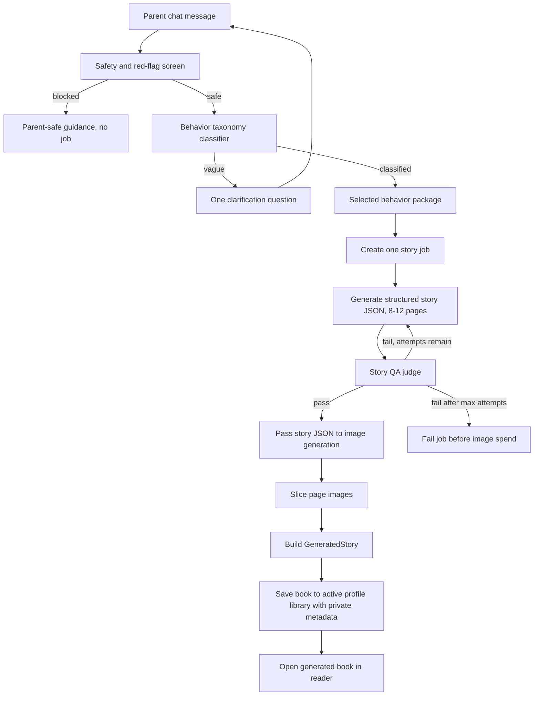

# Story Generation Spec

## Goal

Improve story generation so parents get focused, high-quality picture-book text from behavior prompts.

This spec covers:

- behavior taxonomy classification of parent prompts
- one-turn guided chat clarification for vague prompts
- automatic primary behavior selection for multi-issue prompts
- A-level story quality
- structured story JSON
- flexible 8-12 page story output

Image generation requirements live in `docs/image-generation-spec.md`.

Prewritten behavior story concept library requirements live in
`docs/brainstorms/2026-05-25-behavior-story-library-requirements.md`.
That offline library is separate from live 12-page story generation: it stores
short reusable story concepts for review before any later app integration.

## Source Feedback

Key feedback:

- A prompt like `Meltdowns during transitions, Demanding screens constantly` contains two issues. The first issue should generate now; the UI should clearly say that one book is generated for one issue at a time.
- Current stories are useful but feel like B-/C+ stories.
- Target quality is A/A+, with A- as the minimum.

## Current Story Flow

1. Mobile captures the parent request in a compact guided chat.
2. API runs auth and input safety checks before behavior classification.
3. Safe behavior prompts are mapped to a curated behavior package: scene, visible behavior, likely mechanism, strategy, child story skill, parent note, and target outcome.
4. Vague prompts return one clarification question without starting provider-backed generation.
5. Clear prompts start one background story-sheet job and return one `bookId`.
6. Job writes one structured story JSON with 8-12 story pages.
7. API runs a structured story-quality QA pass before image generation.
8. If QA fails, the text model rewrites the story with the QA issues; image generation does not start yet.
9. Story JSON is passed to image generation and slicing only after QA passes.
10. Mobile polls one job until complete.
11. Mobile fetches one generated story, saves it to the active profile library with private classification metadata, and opens the reader.

## Required Behavior

### 1. Behavior Taxonomy Classification

When a parent prompt describes a common child behavior, the system should classify it into:

- scene/context
- visible behavior
- likely mechanism
- mainstream, non-clinical strategy
- child story skill
- short parent guidance
- target outcome

The classification is the source of truth for the story prompt. Raw parent text can provide context, but the generated book should focus on the selected behavior package.

### 2. Clarification for Vague Prompts

When a parent prompt is too vague to classify safely, Kahani asks one clarifying question in the create-story chat. It should not start a provider job until the parent answers.

Example:

```text
bedtime is awful
```

Expected response:

```json
{
  "status": "needs_clarification",
  "clarification": {
    "question": "What is the clearest thing your child does in that moment?"
  }
}
```

After the answer, the API maps the combined request to the closest safe known category or declines if it remains outside scope.

### 3. Multi-Issue Primary Selection

When a parent prompt contains multiple distinct behavior issues, the system should generate only one focused book. The primary issue is selected by the most emotionally intense visible behavior, not by text order. Secondary issues may be saved as private metadata, but they must not become subplots.

Example:

```text
won't change clothes, asks me to stay, and screams when bedtime starts
```

Expected generation plan:

```json
{
  "primary": {
    "scene": "bedtime",
    "visibleBehavior": "screams or melts down when bedtime begins",
    "mechanism": "overwhelmed transition",
    "strategy": "co-regulation first, then one tiny bedtime step"
  }
}
```

### 4. Story QA Before Images

The text stage must not trust the first model draft. Before storyboard image generation starts, the API runs a structured story-quality QA pass. The QA judge scores the story and checks whether:

- the story reads like one real 5-10 minute scene where something happens
- the parent action is practical, specific, and parent-recognizable
- the parent action is grounded in a mainstream behavior strategy for the exact issue, such as CDC/AAP positive discipline, Montessori discipline, positive behavior support, or child-behavior expert practice
- the child performs one visible next-step behavior that matches the prompt
- choices are logical and both lead toward the target action
- rewards or incentives come only after the desired behavior
- the story avoids unsafe, gross, nonsensical, vague, or symbolic fixes

The QA bar is behavior-specific, not generic. For example, rude-tone stories must show a calm communication boundary, a modeled respectful replacement phrase, and the child retrying with kinder words. Cleanup stories must put the object where it belongs. Screen-limit stories must keep the screen limit. Safety stories must block danger before choices or rewards.

If the story scores below the pass threshold, the text model rewrites the story using the exact QA issues. The API may try up to three text attempts. If no attempt passes, the job fails before image generation so the app does not spend image tokens or save a bad story.

The first issue should produce:

- story JSON
- generated story response
- saved library entry

Remaining issues should not be automatically generated. The parent can prompt again if they want another book.

Single-issue prompts should continue to produce one book.

### 4. Multi-Issue Copy

When more than one behavior issue is detected, show copy after starting the first story.

Suggested copy:

```text
We can generate one book for one issue at a time.
Generating this book for: Meltdowns during transitions.
```

Behavior:

- Use the first detected issue for the current story.
- Clearly name the issue being used for the current story.
- Do not show remaining-issue buttons.
- Do not automatically generate every issue in the original prompt.
- Let the parent prompt again if they want another story.

### 5. A-Level Story Quality

The story prompt should explicitly optimize for:

- emotional clarity
- story structure
- voice
- originality
- visual imagery
- child realism
- sentence rhythm
- memorability
- literary quality
- parent usefulness

The story should not read like instructions or therapy advice. The behavioral skill should appear through action, ritual, imagery, and repair.

Quality target:

- A/A+ desired
- A- minimum accepted

Story quality requirements:

- Use a concrete child-scale situation, not a generic moral.
- Give the child a believable emotional body response.
- Give the parent a useful but non-preachy intervention.
- Include one memorable object, phrase, image, or ritual that can anchor the story.
- Build a full arc: attachment to current state, rupture, co-regulation, small attempt, repair, return.
- Keep sentence rhythm suitable for read-aloud picture books.
- Avoid generic lines like "Liam learned it was okay" unless grounded in action.

### 6. Structured Story JSON

Each generated book should produce structured JSON with:

- title
- child name
- parent name and role
- normalized behavior
- 8-12 story pages
- each page's story text
- each page's visual scene
- each page's composition
- each page's emotion

The story text is the source of truth for the reader UI.

## Proposed Architecture



## Implementation Plan

### Phase 1: Story Planning Contract

Add a deterministic planning step before story generation.

Inputs:

- `mode`
- raw parent `prompt`
- selected character metadata

Output:

- normalized list of story issues
- one issue for single-issue prompts
- multiple issues for multi-issue prompts

For v1, use conservative splitting:

- split obvious comma-separated or newline-separated issue phrases
- trim and discard empty entries
- cap generated books per request, likely 3
- do not split short phrases that are clearly one combined idea

### Phase 2: Multi-Issue UX

Update generation so a single request:

- generates one book for the first detected issue
- returns the issue being used for the current book
- returns a short notice when more than one issue was detected

Preferred v1 behavior:

- API continues to start one normal story job
- the story job uses the first planned issue
- mobile saves and opens the generated book as it does today
- mobile shows copy explaining that one book can be generated for one issue at a time
- mobile names the issue being generated
- parent can prompt again if they want another story

### Phase 3: Story Prompt Upgrade

Revise `story-json-master-prompt.txt` to encode the A-level rubric.

Prompt changes should require:

- picture-book voice
- stronger scene specificity
- fresh metaphor or ritual
- real toddler/preschool emotional behavior
- parent usefulness through action, not explanation
- no lesson-summary ending unless earned by action

## Acceptance Criteria

### Multi-Issue Prompt

Given:

```text
Meltdowns during transitions, Demanding screens constantly
```

Expected:

- one book is generated immediately
- the generated book focuses only on transition meltdowns
- the book is saved in the active profile library
- the book does not appear in another profile's library
- the UI says one book can be generated for one issue at a time
- the UI names the first issue as the one being generated
- no remaining-issue buttons are shown

### Single-Issue Prompt

Given:

```text
Meltdowns during transitions
```

Expected:

- one book is generated
- story remains focused on transitions only
- no screen-demand storyline is introduced

### Story Quality

For `Meltdowns during transitions`, the generated story should meet A- or better in:

- emotional clarity
- story structure
- voice
- originality
- visual imagery
- child realism
- sentence rhythm
- memorability
- literary quality
- parent usefulness

## Open Questions

- Should each split issue preserve the original prompt as metadata for debugging?
